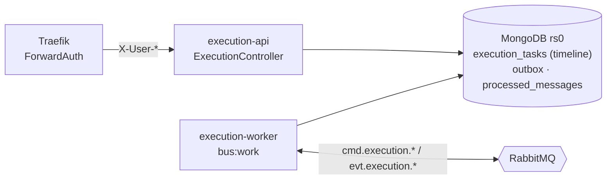

# 15SOAT-Fase1-execution — Execution Service

Microsserviço de **execução e produção** da Workshop OS (Fase 4 — SOAT/FIAP).

- Gerencia a fila de execução da OS (diagnóstico e reparo), com prioridade: reparos aprovados vêm antes de novos diagnósticos.
- Atualiza o status durante o diagnóstico e o reparo (`/api/v1/executions/{id}/diagnosis|repair/start|finish`).
- Comunica a finalização ao OS Service via `evt.execution.repair_finished`.
- Recusa trabalho quando a oficina está lotada (`EXECUTION_QUEUE_CAPACITY`) e a saga compensa.

Banco: **MongoDB** (o NoSQL exigido pela Fase 4, [ADR-012](https://github.com/CandidoRPNeto/15SOAT-Fase1/blob/master/docs/architecture/adrs/adr-012-mongodb-execution-store.md)), com um documento por OS e a timeline embutida.

## Arquitetura do serviço



| Camada | Conteúdo |
|---|---|
| `app/Domain/Execution` | `ExecutionMessage`, `ExecutionPhase`, `ExecutionStatus` |
| `app/Application/Execution` | `EnqueueTask`, `CancelTask` (compensação), `ProgressTask`, `ExecutionMessageRouter` |
| `app/Models` | `ExecutionTask`, `OutboxMessage`, `ProcessedMessage` (MongoDB) |

Contrato das mensagens: [`docs/asyncapi.yaml`](docs/asyncapi.yaml).

## Tecnologias

Laravel 13 · PHP 8.4 · MongoDB 7 (`mongodb/laravel-mongodb`, replica set) · RabbitMQ · L5-Swagger · Datadog APM · Docker · Kubernetes (kind) · GitHub Actions · SonarCloud.

## Executar

Os testes usam MongoDB real em replica set (transações):

```bash
docker run -d --name mongo-test -p 27018:27017 mongo:7 --replSet rs0 --bind_ip_all
docker exec mongo-test mongosh --eval 'rs.initiate({_id:"rs0",members:[{_id:0,host:"127.0.0.1:27017"}]})'
MONGODB_URI='mongodb://127.0.0.1:27018/?replicaSet=rs0&directConnection=true' php artisan test   # PHP com ext-mongodb
```

Deploy no Kubernetes (plataforma em
[15SOAT-Fase1-kubernetes](https://github.com/CandidoRPNeto/15SOAT-Fase1-kubernetes)):

```bash
export KUBECONFIG=~/.kube/workshop-os-config
scripts/deploy-kind.sh ghcr.io/candidorpneto/15soat-fase1-execution:<tag>
```

Manifests: `k8s/` (namespace `execution`):
- `execution-api` + HPA;
- `execution-worker`;
- StatefulSet `execution-mongo`;
- Job `execution-migrate`, que faz o `rs.initiate` e cria os índices;
- Ingress com ForwardAuth.

## CI/CD

`.github/workflows/ci-cd.yml`:
1. **test** — MongoDB replica set + RabbitMQ reais, cobertura ≥ 80%;
2. **quality** — Pint + SonarCloud;
3. **build** — GHCR;
4. **deploy** — runner self-hosted → kind, só em push na `main`.

## API

- Swagger: http://localhost:30080/execution/api/documentation
- Rotas (staff, via gateway): `GET /api/v1/executions`, `GET /api/v1/executions/{serviceOrderId}`, `POST /api/v1/executions/{serviceOrderId}/diagnosis/start|finish`, `POST /api/v1/executions/{serviceOrderId}/repair/start|finish`.

## Cobertura

Local, sem broker: ~81%. No CI, com RabbitMQ real, os adapters também são cobertos. Relatório: artefato `coverage` do workflow e SonarCloud.
